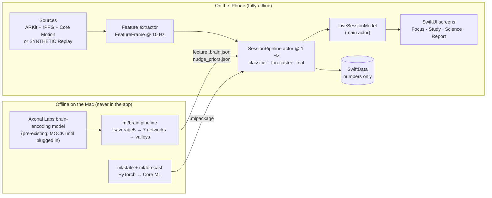

# FocusLoop

**FocusLoop predicts when your attention is about to slip and catches it before it does.**

> *"The same neuroscience that tells advertisers what captures attention, used to help students protect theirs."*

FocusLoop is an iOS app built for the Congressional App Challenge. You prop your iPhone next to your laptop with the front camera facing you and study as usual, or you watch a bundled lecture inside the app (Study Mode). On the device, FocusLoop reads attention signals and heart rate from the camera. It combines them with a brain-encoding model's predicted brain response to the lecture (average brain) to forecast a lapse up to 15 seconds ahead. When a lapse looks likely, it nudges you gently, and it runs a small personal experiment in every session to learn which nudges actually bring *you* back.

Everything runs on the phone. The app makes no network calls, and it never stores or sends video.

FocusLoop is a **wellness tool that supports focus**. It is not a medical device, and it does not diagnose or treat any condition.

---

## Who it's for

FocusLoop is for students with ADHD and for anyone who struggles to stay focused while studying.

The need is large. In the CDC's 2022 National Survey of Children's Health, parents reported the following for U.S. children aged 3–17 (Danielson et al., 2024):

- **11.4% (7.1 million)** had ever received an ADHD diagnosis (about 1 in 9).
- **10.5% (6.5 million)** had current ADHD.
- Of children with current ADHD, **58.1%** had moderate or severe ADHD and **77.9%** had at least one co-occurring disorder. **53.6%** received ADHD medication, **44.4%** received behavioral treatment in the past year, and **30.1%** received no ADHD-specific treatment.

FocusLoop does not replace care. You don't need a diagnosis to use it, and it never asks for or records one. It is a study companion that helps any student notice drift sooner and learn what helps them refocus.

---

## How it works

FocusLoop runs one loop, every second of every session.

**1. Sense.** ARKit face tracking reads blendshapes (blinks, eye direction, squint, jaw, brow), gaze and head pose from the TrueDepth camera. From these, FocusLoop derives blink rate and duration, PERCLOS, yawns, head nods, gaze deviation from your calibrated work zone, and brow tension. Core Motion detects when you pick up the phone. Camera heart rate (rPPG) averages the colour of forehead and cheek skin and recovers the pulse with the POS algorithm. Only numbers leave this stage: a 42-value `FeatureFrame` at 10 Hz.

**2. Understand.** Once per second, a small temporal network (a dilated 1D-CNN in Core ML) classifies the last 10 seconds into one of four states: **focused, distracted, drowsy, stressed**. A rule-based classifier with the same interface takes over when the model is missing or unsure. An on-device logistic-regression "personal head" learns from your own labels and blends in as they accumulate.

**3. Predict.** The `LapseForecaster` looks at the last 20 seconds of your signals, plus the lecture's predicted brain response for the same 20 seconds, and outputs P(lapse within the next 15 s). When that probability crosses your personal threshold while you are still focused, FocusLoop can act *before* you drift. The Science view draws the forecast as a line running ahead of "now".

**4. Intervene.** A micro-randomized trial engine picks the nudge. It uses Thompson sampling over the arms that fit your state: a glow, a haptic tap, a chime, a "put me down" card, a recap card, a stretch break, paced breathing with live heart-rate biofeedback, or, pre-emptively, a soft glow or an active-recall question just before a predicted content valley. A small-probability **no-nudge control** is always in the mix, and the exact probability of every choice is logged.

**5. Measure.** FocusLoop times how long it takes you to return to focused ("Back in 2.8 s"). A nudge earns a reward if you refocus within 20 seconds, or, for a pre-emptive nudge, if no lapse follows within the forecast horizon. Dismissing a nudge carries a penalty.

**6. Learn.** Each outcome updates the trial's posteriors, your personal effect estimates (inverse-probability weighted against the no-nudge control, with intervals), your personal state model and your forecast threshold. The on-device coach turns aggregated numbers into short, plain-language insights: when focus tends to drop, which nudges work for you, your best hours, and how your drift lined up with the lecture's predicted valleys.


**Sustained-attention profile.** Every run of the three-minute SART (Robertson et al., 1997 timing: 250 ms digit, 900 ms mask, no-go 3; 160 trials by default) is saved. The Attention Profile shows the latest run's taps on 3 (commission error rate), missed digits (omissions), mean response time, response-time variability (SD and coefficient of variation) and too-fast taps (< 100 ms), trends across runs, a plain-English explainer, and published reference ranges from verified sources only (Cheyne et al., 2009 and 2006), with a note that those studies used 225 trials. Runs done in the Simulator are marked (the taps are real; there is no camera).

**Share with your doctor.** One tap makes a print-friendly, multi-page US Letter PDF on the phone (Attention Profile or Settings → Your data): overview, SART runs, camera heart rate, what helped (effects with intervals, "still learning" when an interval crosses zero), check-in answers and notes for the clinician. Every page says it is not a diagnosis. By default it includes only real sessions; demo sessions (replay, recorded video, Demo Director) can be added and are then marked "demo data". Nothing is sent automatically.
---

## Architecture



---

## Build and run

Requirements: macOS with Xcode 26 (built with Xcode 26.6; the deployment target is iOS 17.0), Homebrew, and Python 3.11–3.12 via `uv` for the offline ML tooling. Foundation Models coach insights need iOS 26 and a supported device; everywhere else FocusLoop falls back to template insights.

### 1. One-time setup

```bash
brew install xcodegen ffmpeg                          # XcodeGen generates the project; ffmpeg is for lectures
curl -LsSf https://astral.sh/uv/install.sh | sh       # Python environment manager
cd ml && ~/.local/bin/uv sync --python 3.12 && cd ..  # pinned Python deps (ml/pyproject.toml, ml/uv.lock)
xcodegen generate                                     # creates FocusLoop.xcodeproj from project.yml
```

`project.yml` is the only source of truth for the project. Never hand-edit `FocusLoop.xcodeproj`; it is gitignored and regenerated.

### 2. Run in the Simulator (Replay)

ARKit face tracking isn't available in the Simulator, so FocusLoop automatically plays the **SYNTHETIC** replay stream (`Resources/Replay/synthetic_session.replay.csv`, 180 s at 10 Hz) through the full pipeline. Metal runs in the Simulator, so the cortex renders. Every screen driven by Replay carries a **SYNTHETIC** badge, and every screen using the bundled brain timelines carries a **MOCK** badge.

```bash
open FocusLoop.xcodeproj        # pick an iPhone Simulator (e.g. iPhone 17 Pro) and Run
# or, from the command line, build and run all unit + integration tests:
xcodebuild -project FocusLoop.xcodeproj -scheme FocusLoop \
  -destination 'platform=iOS Simulator,name=iPhone 17 Pro' test
ml/run_tests.sh                 # every Python test suite (schemas, brain pipeline, labels, POS reference)
```

Useful launch arguments: `-debugBrainDemo` (the brain kit's `BrainCortexDemoView`), `-debugStudyMode` / `-debugStudyPicker` (Study Mode on the MOCK sample), `-screen <name>` (open a given screen), and `-previewServices` (the UI module's SYNTHETIC preview services, for screenshots only).

### 3. Run on a device

You need an iPhone with a TrueDepth (Face ID) camera. Before building, set your signing team: set `DEVELOPMENT_TEAM` in `project.yml`, then run `xcodegen generate` (HealthKit needs a paid developer account). Select the phone in Xcode and Run. Then:

- Make sure **Settings → Force Replay** is off. The SYNTHETIC badge disappears when live sensors are in use.
- Onboarding walks you through permissions, work-zone calibration (look at your laptop's centre and four corners) and a ~3-minute SART.
- **Settings → Demo Director** lowers thresholds so states are easy to trigger on camera. It is for **demonstration only** and is badged on screen. Never use it for results.

### 4. Offline ML (optional)

| Step | Command |
|---|---|
| Regenerate `FeatureFrame.swift` from the schema | `python3 ml/schema/gen_feature_frame.py` |
| Retrain the state model on exported label CSVs | `ml/state/retrain.sh ml/data/labels/` |
| Train / evaluate / ablate / export the forecaster | `ml/.venv/bin/python ml/forecast/{train,eval,ablation,export_coreml}.py --manifest ml/data/forecast/manifest.csv` (the app writes the manifest: Settings → Export feature streams; see `ml/forecast/README.md`) |
| Recompute lecture brain timelines | `ml/.venv/bin/python ml/brain/precompute_content.py --all` |
| Re-score nudge priors | `ml/.venv/bin/python ml/brain/score_nudges.py` |
| Camera HR vs Apple Watch | `ml/.venv/bin/python ml/rppg_validate.py --rppg focusloop_hr.csv --watch watch_hr.csv` |

---

## The science

| Component | Method | Source |
|---|---|---|
| Camera heart rate | POS (Plane-Orthogonal-to-Skin) rPPG, detrend, 0.7–3.0 Hz bandpass, Hann-windowed FFT over 10 s, SNR quality index, motion gating | Wang et al., 2017 [1]; SNR from de Haan & Jeanne, 2013 [2] |
| Drowsiness | PERCLOS: fraction of frames with eye closure above 0.8 over 60 s | Dinges & Grace, 1998 [3]; Wierwille et al., 1994 [4] |
| Lapse labels | Sustained Attention to Response Task (SART): commission errors and RT-variability spikes mark lapse windows | Robertson et al., 1997 [5] |
| Nudge selection | Thompson sampling with Beta-Bernoulli posteriors | Thompson, 1933 [6] |
| Personal trial | Micro-randomized trial with logged randomization probabilities and IPW effect estimates vs a no-nudge control | Klasnja et al., 2015 [7] |
| Nudge timing | Just-in-time adaptive intervention design | Nahum-Shani et al., 2018 [8] |
| Brain surface | fsaverage5 cortical surface (FreeSurfer), via TemplateFlow | Fischl, 2012 [9]; Ciric et al., 2022 [10] |
| Brain networks | Yeo 7-network parcellation | Yeo et al., 2011 [11] |
| Network labels per vertex | Schaefer-400 parcels, 7-network labels (CBIG) | Schaefer et al., 2018 [12] |
| Prevalence figures | CDC, 2022 National Survey of Children's Health | Danielson et al., 2024 [13] |

These methods are implemented from the papers. No third-party algorithm code is in the repository.

### References

All citations and figures were checked against primary sources.

1. Wang W, den Brinker AC, Stuijk S, de Haan G. "Algorithmic Principles of Remote PPG." *IEEE Transactions on Biomedical Engineering* 2017;64(7):1479–1491. doi:10.1109/TBME.2016.2609282
2. de Haan G, Jeanne V. "Robust Pulse Rate From Chrominance-Based rPPG." *IEEE Transactions on Biomedical Engineering* 2013;60(10):2878–2886. doi:10.1109/TBME.2013.2266196
3. Dinges DF, Grace R. "PERCLOS: A Valid Psychophysiological Measure of Alertness As Assessed by Psychomotor Vigilance." Tech Brief, Publication No. FHWA-MCRT-98-006, U.S. Department of Transportation, Federal Highway Administration, October 1998. doi:10.21949/1502740
4. Wierwille WW, Ellsworth LA, Wreggit SS, Fairbanks RJ, Kirn CL. "Research on Vehicle-Based Driver Status/Performance Monitoring: Development, Validation, and Refinement of Algorithms for Detection of Driver Drowsiness." Final Report, DOT HS 808 247, National Highway Traffic Safety Administration, December 1994.
5. Robertson IH, Manly T, Andrade J, Baddeley BT, Yiend J. "'Oops!': Performance correlates of everyday attentional failures in traumatic brain injured and normal subjects." *Neuropsychologia* 1997;35(6):747–758. doi:10.1016/S0028-3932(97)00015-8
6. Thompson WR. "On the likelihood that one unknown probability exceeds another in view of the evidence of two samples." *Biometrika* 1933;25(3/4):285–294. doi:10.1093/biomet/25.3-4.285
7. Klasnja P, Hekler EB, Shiffman S, Boruvka A, Almirall D, Tewari A, Murphy SA. "Microrandomized trials: An experimental design for developing just-in-time adaptive interventions." *Health Psychology* 2015;34(Suppl):1220–1228. doi:10.1037/hea0000305
8. Nahum-Shani I, Smith SN, Spring BJ, Collins LM, Witkiewitz K, Tewari A, Murphy SA. "Just-in-Time Adaptive Interventions (JITAIs) in Mobile Health: Key Components and Design Principles for Ongoing Health Behavior Support." *Annals of Behavioral Medicine* 2018;52(6):446–462. doi:10.1007/s12160-016-9830-8
9. Fischl B. "FreeSurfer." *NeuroImage* 2012;62(2):774–781. doi:10.1016/j.neuroimage.2012.01.021
10. Ciric R, Thompson WH, Lorenz R, et al. "TemplateFlow: FAIR-sharing of multi-scale, multi-species brain models." *Nature Methods* 2022;19(12):1568–1571. doi:10.1038/s41592-022-01681-2
11. Yeo BTT, Krienen FM, Sepulcre J, et al. "The organization of the human cerebral cortex estimated by intrinsic functional connectivity." *Journal of Neurophysiology* 2011;106(3):1125–1165. doi:10.1152/jn.00338.2011
12. Schaefer A, Kong R, Gordon EM, et al. "Local-Global Parcellation of the Human Cerebral Cortex from Intrinsic Functional Connectivity MRI." *Cerebral Cortex* 2018;28(9):3095–3114. doi:10.1093/cercor/bhx179
13. Danielson ML, Claussen AH, Bitsko RH, Katz SM, Newsome K, Blumberg SJ, Kogan MD, Ghandour R. "ADHD Prevalence Among U.S. Children and Adolescents in 2022: Diagnosis, Severity, Co-Occurring Disorders, and Treatment." *Journal of Clinical Child & Adolescent Psychology* 2024;53(3):343–360. doi:10.1080/15374416.2024.2335625. Open access: https://pmc.ncbi.nlm.nih.gov/articles/PMC11334226/
14. Cheyne JA, Solman GJF, Carriere JSA, Smilek D. "Anatomy of an error: A bidirectional state model of task engagement/disengagement and attention-related errors." *Cognition* 2009;111(1):98–113. doi:10.1016/j.cognition.2008.12.009 (SART reference ranges)
15. Cheyne JA, Carriere JSA, Smilek D. "Absent-mindedness: Lapses of conscious awareness and everyday cognitive failures." *Consciousness and Cognition* 2006;15(3):578–592. doi:10.1016/j.concog.2005.11.009 (SART response-time range)

---

## The brain-encoding content layer (Axonal Labs model)

> **Pre-existing work.** The Axonal Labs brain-encoding foundation model, and the Axonal Labs website cortex (mesh, shader, easing) that the in-app cortex is ported from, were built by the team **before** this project.

**What it does.** The Axonal Labs model takes a video's frames, audio and transcript and predicts the fMRI response that content would evoke in an **average brain**. FocusLoop uses those predictions as a forecast of how a lecture is likely to pull on attention, second by second.

**Where it runs.** The model runs **offline, on the Mac only**, to precompute lecture timelines. The app never calls it and stays fully offline. The pipeline in `ml/brain/` goes from `prepare_stimulus.py` (frames, audio, transcript) to `run_brain_model.py` (the single model adapter) to `to_networks.py`, which projects the predictions onto fsaverage5, averages them into the 7 Yeo networks using the bundled Schaefer labels, shifts for hemodynamic lag (5 s), resamples to 1 Hz and z-scores within the lecture. `precompute_content.py` then writes `Resources/Lectures/<id>.brain.json` with the network series, a 0–1 predicted engagement (dorsal attention + ventral attention + visual), a predicted drift risk (default mode relative to dorsal attention) and "valleys" (low-engagement stretches of 6 s or more). `score_nudges.py` turns predicted responses to each nudge into weak Beta priors for the trial engine.

**How it's shown.** In the app, this layer is always labelled **"Predicted brain response to this content (average brain)"**. The rotating cortex shows the model's prediction for the lecture. It is never a measurement of the student, and it is never the student's own brain. The forecaster uses it as one input, alongside the student's own camera signals.

**Status: MOCK.** The real model has not been plugged in yet. `run_brain_model.py` ships a clearly marked **MOCK** stand-in, driven by simple stimulus features (motion, luminance, cuts, loudness, speech rate) convolved with a canonical HRF. It is not a brain model. Every bundled timeline and `nudge_priors.json` say `"mock": true`, and the app shows a **MOCK** badge wherever they appear. Once the real model is plugged in, the badges disappear on their own.

Bundled demo lectures (see Credits below): NASA/JPL "What is a black hole?" (public domain), California Academy of Sciences "Travel Deep Inside a Leaf" (CC BY 3.0) and Bill Hammack's engineerguy "How a Laser Works" (CC BY 3.0).

---

## Results

**Only real data goes here.** No real-data runs have been done yet. Every cell stays as shown until real-data runs have been completed, and nothing synthetic or mock may ever be pasted into this table.

| Measure | Result |
|---|---|
| Attention-state model: accuracy, macro-F1, confusion matrix (held-out participants) | TBD (pending real data) |
| Attention-state model: calibration (ECE, reliability plot) | TBD (pending real data) |
| LapseForecaster: AUROC | TBD (pending real data) |
| LapseForecaster: precision at a 10% alert rate | TBD (pending real data) |
| LapseForecaster: median lead time before real lapses | TBD (pending real data) |
| Brain-content ablation: forecaster with vs without content features | TBD (pending real data) |
| Camera heart rate vs Apple Watch: MAE, RMSE, Bland–Altman bias and limits | TBD (pending real data) |
| Mini-study: change in SART commission errors, FocusLoop on vs sensing only | TBD (pending real data) |
| Mini-study: change in SART RT coefficient of variation | TBD (pending real data) |
| Mini-study: median refocus time and off-task time | TBD (pending real data) |
| Personal trial: per-arm effect estimates vs no-nudge | TBD (pending real data) |

The planned study is a small, within-subject, counterbalanced pilot (3+ participants).

### Pipeline checks on SYNTHETIC data (not results)

These numbers only show that the code paths run and behave as expected on data we generated ourselves. **They are not evidence that FocusLoop works.** The synthetic generator was scripted to tie lapses to the MOCK content and to produce clean state signatures, so a model that does well on it has only learned the script back. Real performance can only come from the real-data runs above.

- SYNTHETIC: The heuristic state classifier's rules score 0.977 accuracy on the SYNTHETIC replay stream (Python port of the Swift rules, `ml/state/heuristic.py`).
- SYNTHETIC (Phase 4 generator: simulated sensors run through a port of the live feature extractor, ~5% label noise): on 9 held-out synthetic subjects the state model reaches macro-F1 0.85 (heuristic 0.76), and 0.98 accuracy on the replay (heuristic 0.98). The pre-Phase-4 model scored 0.47 on the same held-out subjects.
- SYNTHETIC: Forecaster ablation (3 seeds, 25 held-out synthetic subjects), AUROC 0.73 with MOCK content features vs 0.57 without. The gap exists only because the synthetic generator ties lapses to MOCK content; the sensor-only precursors are an assumption of the generator.
- SIMULATED: Trial engine convergence on a simulated user (20 seeds × 600 decisions): best arm identified in 20/20 seeds, median 95 decisions to P(best) > 0.9, 90% interval coverage 0.91.
- SYNTHETIC: FocusLoop's independent numpy POS (the reference for the Swift POS) matched the rPPG-Toolbox POS core with r = 1.000 on SYNTHETIC signals. This was an offline cross-check only; no Toolbox code is in the repository.
- SYNTHETIC/MOCK: The end-to-end integration test (SYNTHETIC replay, MOCK lecture timeline) classified all four states, fired a pre-emptive glow, randomized reactive decisions including the control, and produced a report with drift-overlay r = 0.22.

---

## Privacy

- **No network calls.** The app contains no networking code and no analytics or third-party SDKs. It works the same in Airplane Mode.
- **0 bytes of video stored or sent.** Camera frames are processed in memory and immediately reduced to numbers. No image, video, audio or face mesh is ever written to disk. The face-mesh overlay in the Science view is drawn live and never saved.
- **What is stored, on the device only:**
  - Sessions in SwiftData (local-only, no CloudKit): start time, duration, lecture ID and MOCK/SYNTHETIC flags, 1-second summaries (state, probabilities, lapse risk, heart rate, playhead, predicted engagement), session events, trial decisions with their randomization probabilities, trial outcomes, and coach insight text generated from aggregated numbers.
  - Learned settings: the personal head's weights, the trial posteriors, the forecaster threshold and the resting heart-rate baseline.
  - Every SART run (date, task settings, per-trial digit / tap / reaction time, computed scores), numbers only.
  - Labelled feature windows (numbers only, from SART and "Were you focused?" answers) in the app's Application Support folder, for retraining.
  - Only if you turn on **Settings → Record feature streams**: each session's 10 Hz numeric features (no images), also in Application Support, for retraining the forecaster. Off by default.
  - Preferences (feature flags, onboarding progress) and the calibrated work-zone angles (laptop and phone screen) in `UserDefaults` under `focusloop.` keys.
- **Replay never mixes with your data.** Sessions on the SYNTHETIC replay stream use a separate trial, personal model and label store, so your real Personal Trial and exports only contain real sessions.
- **Exports are explicit.** CSV, PDF and PNG exports happen only when you tap them, via the share sheet. Once shared, the data leaves the app's control.
- **Delete all data** on the Privacy screen wipes every stored record, every export, every learned setting and every preference.

---

## Limitations


1. **It's not a medical device.** FocusLoop is a wellness tool that supports focus. It does not diagnose or treat ADHD or any condition, and its heart-rate readings are for biofeedback and trends only.
2. **Lighting and motion affect accuracy.** Gaze, blinks and especially camera heart rate get worse in dim, flickering or strongly coloured light, and when the head or phone moves.
3. **rPPG accuracy can vary with skin tone and needs broader testing.** FocusLoop's camera heart rate has not yet been validated across a diverse group of people.
4. **Brain predictions reflect an average brain, not the individual.** The content layer is a model's prediction for the lecture, not a reading of the student. Until the Axonal Labs model is plugged in, it is MOCK.
5. **Studies so far are small.** Any results will come from a small pilot, and they are not evidence of efficacy in the general population.

In addition, the bundled state and forecast models are trained on SYNTHETIC data until real sessions are collected, personal-trial estimates are noisy at the start, and the cool-light pulse is an experimental arm that FocusLoop is testing, not one it claims works.

---

## Future work

- Plug in the Axonal Labs model and replace every MOCK timeline and the MOCK nudge priors.
- Collect real sessions, retrain both models, and fill in the Results table.
- Validate camera heart rate against an Apple Watch across a wide range of skin tones and lighting conditions.
- Run a larger, pre-registered study after the pilot.
- Turn on contextual (linear) Thompson sampling: `LinearThompsonEngine` is implemented and tested, but the app uses the Beta-Bernoulli `ThompsonTrialEngine` by default.
- Add an Apple Watch wrist-tap nudge (a `watchTap` feature flag exists; the companion app is not built).
- Use an adaptive blink threshold so heavy drowsiness doesn't merge blinks.

---

## Credits and third party

FocusLoop ships no third-party code libraries, only Apple frameworks plus code written for this project.

- **Lecture videos** (`Resources/Lectures/`): "What is a black hole? Astro-Investigates Ep. 1", NASA/JPL-Caltech (NASA Scientific Visualization Studio, public domain); "Travel Deep Inside a Leaf (Annotated Version)", California Academy of Sciences, [CC BY 3.0](https://creativecommons.org/licenses/by/3.0/); "How a Laser Works (EngineerGuy Series #4)", Bill Hammack, engineerguy, [CC BY 3.0](https://creativecommons.org/licenses/by/3.0/). Transcripts in `ml/brain/transcripts/` come from the same sources (the laser transcript is Wikimedia Commons text, CC BY-SA).
- **Brain surface:** fsaverage / fsaverage5 (FreeSurfer; Fischl, 2012), via TemplateFlow (Ciric et al., 2022), used under the FreeSurfer license with attribution.
- **Brain networks:** Yeo-7 networks (Yeo et al., 2011) and the Schaefer-400 parcellation with 7-network labels (Schaefer et al., 2018), from the CBIG repository (ThomasYeoLab/CBIG), MIT License.
- **Tools:** XcodeGen (MIT) generates the Xcode project; the offline ML pipeline uses numpy, scipy, pandas, scikit-learn, torch, coremltools, matplotlib, nibabel, nilearn and jsonschema (pinned in `ml/pyproject.toml`), all under permissive licenses.
- **Pre-existing work:** the Axonal Labs brain-encoding foundation model and the Axonal Labs website cortex (mesh, shader, easing) were built by the team before this project.
